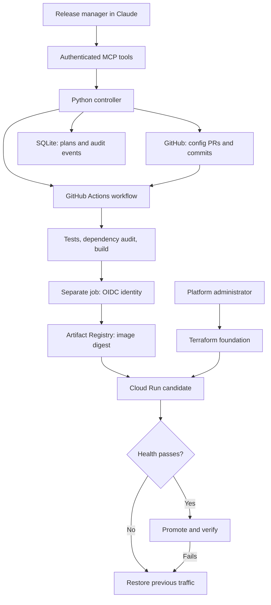
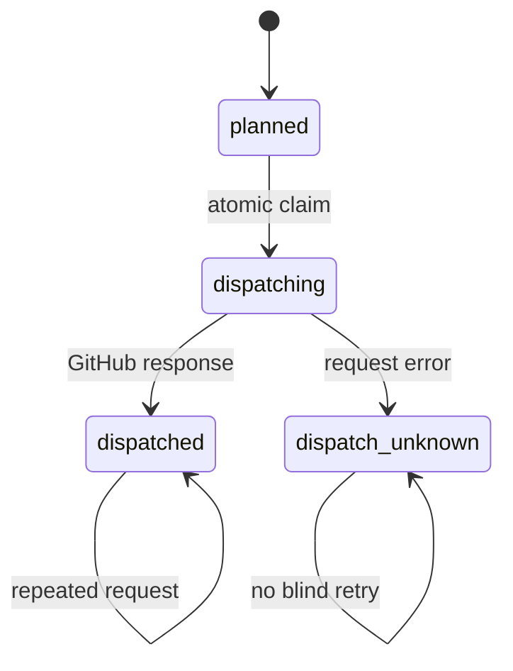

# Architecture and boundaries

## Ownership

| Component | Owns |
|---|---|
| Claude | Interpreting requests and selecting exposed tools |
| App repository | Reviewed code, tests, Dockerfile and desired app settings |
| Operator configuration | Allowed apps, authenticated principals and write permission |
| Python policy | Supported targets, resource limits and required review state |
| SQLite | Plans, dispatch states and audit event timestamps |
| GitHub Actions | Build and release execution, job status and receipts |
| Terraform | Cloud IAM, WIF provider, Artifact Registry and initial service |
| Cloud Run release code | Subsequent container template, revision and traffic settings |

The deterministic policy functions are deliberately small for this MVP. OPA is not required to enforce these first rules. An OPA adapter can replace or augment the policy interface when policies span more services and teams.

## Config generation

The analyzer reads only known text manifests and a Dockerfile. It does not import repository code, run shell commands from a README, read `.env`, install app dependencies, or pass repository prose into a privileged execution loop. Manifest observations are hints. Traffic, persistent state, secrets, and memory needs require human review or measured telemetry.

The MCP analyzer returns structured evidence and a draft. The onboarding tool can create a draft PR with `reviewed: false`. That flag is a deployment prerequisite, not a cryptographic approval: branch protection and reviewer controls must ensure only a reviewed change sets it to true. The tool cannot merge PRs.

## Deployment invariants

1. App IDs map to repositories and service names controlled by the operator. Callers cannot supply an arbitrary repository, workflow, shell command, image, cloud account or local path.
2. Caller identity comes from the bearer credential, not a model-supplied username.
3. Plans reference a concrete full commit SHA, canonical spec hash, and exact operator-configured cloud target. The source branch must still match when dispatching, and the workflow checks its own execution SHA against the requested SHA.
4. Workflow parameters are passed through environment variables and validated; they are not interpolated as executable shell code.
5. Test/build runs without cloud OIDC permission. The deployment job executes the pinned platform code, does not install app dependencies, and does not run the application container locally with credentials.
6. The deployment job independently validates the spec and service against environment settings before obtaining GCP access.
7. Image deployment uses an Artifact Registry digest carrying signed SLSA build provenance that the deployment job verifies before release. A bundle checksum additionally catches accidental modification during artifact handling.
8. Cloud Run requires IAM authentication. The probe identity can invoke only the target service. The deployer can generate a probe token without distributing a private key.
9. Promotion failure attempts to restore the exact previous traffic split. Receipt state distinguishes success, traffic restoration and rollback failure.
10. Cloud Run gates traffic on an HTTP startup probe at the reviewed health path, so an instance that never becomes ready is never promoted by the platform's own probes.

## Dispatch state and retries

This prevents duplicate dispatch for the same stored plan. It does not claim exactly-once execution across GitHub and SQLite. A process crash after the atomic claim can leave `dispatching`. A network timeout can mean GitHub accepted a job without returning a response. Status checks use the run ID when available, or a unique plan ID in the workflow title. An operator resolves remaining ambiguity.

Different plans can still request separate releases. Both release and recovery workflows share a concurrency group with `queue: max`, preserving up to 100 pending runs without replacing them by default. Protect the workflow and IAM from alternate writers so the previous traffic snapshot remains meaningful. External manual changes can race this release mechanism.

## Authentication choice

Claude's hosted apps connect through OAuth 2.1: the controller is its own authorization server (`labdeploy/oauth.py`) with PKCE, dynamic client registration restricted to Claude's callback and loopback redirects, single-use codes, one-hour access tokens and rotating thirty-day refresh tokens with reuse detection, all stored as hashes in the same SQLite file. The sign-in page accepts only a configured operator token, so identity still comes from the principal list and rotating a token ends its sessions. Fixed bearer tokens remain for Claude Code, REST and the walkthrough. An identity token is not a GitHub token and never becomes a cloud token. Sign-in through an external identity provider is not implemented; the sign-in page is where it would plug in. Each identity has a request budget and each client address has a failed-login budget, both configurable; the MCP specification requires servers to rate limit tool invocations. The configuration file is re-read when it changes: pauses, principals, applications and their ceilings apply on the next request, while rate limits, the observer identity, OAuth settings, allowed hosts, the log file and the database path take effect at the next start. Rotate operator credentials by replacing their hashes and restarting the service. Tool calls run in a thread pool, so one caller waiting on a status change never blocks sign-ins, health checks or other callers. Use enterprise OAuth before broader multi-user production adoption.

The Python MCP SDK is pinned to the tested v1 series (`mcp==1.30.0`). Its documentation reports v2 as the current stable major. This is a conscious compatibility pin for FastMCP v1 APIs, not a claim to use the newest major. Upgrade as a separate change with protocol and authentication tests.

## Operational limitations

- One controller instance with durable SQLite storage; do not run multiple ephemeral cloud instances against local databases. Use a transactional shared database and durable queue before horizontal scaling.
- Application infrastructure is applied only by the pipeline from merged pull requests: plan on pull request with a read-only identity, a fail-closed policy judged by the rules on `main`, apply on merge with an identity whose federation accepts only that workflow file on `main` in the `infra` environment. The foundation root is applied by the operator from a terminal. Ordinary app releases need no Terraform access at all.
- Cost figures are bounds from list prices plus measured usage, not a bill. The ceiling policy compares the compute bound plus the needs' idle floor with the operator's limit; request fees, egress, scans and builds are outside that number. The spending cap is a Cloud Workflow on budget notifications: at the budget line it closes ingress on every managed service and stops every managed Cloud SQL instance, retrying each one and raising an alert when any fails, and can detach billing at a higher line. It stops future compute minutes after a notification; storage keeps billing, and a service carrying `lab-deploy-cap-lifted=true` is left open deliberately.
- HTTP health checks establish basic readiness, not performance SLO compliance. No canary percentages, metric analysis window, persistent post-release monitoring or Cloud Deploy integration yet.
- Rollback restores traffic only. It cannot undo schema/data changes, application side effects or external outages. A durable GCS checkpoint and separate recovery workflow now support runner loss. Recovery still depends on available APIs, an enabled workflow, environment permissions, and the absence of unrelated traffic changes.
- Python dependency auditing, image vulnerability scanning (report-only unless `BLOCK_ON_CRITICAL_VULNERABILITIES` is set) and signed build provenance with verification are wired. Secret scanning, SBOM generation and Binary Authorization enforcement remain future work.
- The dependency manifests for the controller are hash locked and Actions are commit pinned. The example base container tag is still mutable; pin its reviewed digest and fully lock app dependencies before production use.
- The GitHub App may have broader API capability than the exposed tools. Protect its private key, installation scope, host and default branch. Strong organization policy remains necessary.

## Durable release recovery (0.1.1)

Before changing traffic, the runner writes the previous concrete revision allocations, target, plan ID and release state to a private GCS object. Each state update uses a generation precondition to detect competing writers. Local receipt files are supplementary; they are not the crash-recovery source of truth.

The separate recovery workflow executes only pinned platform code. It shares the release workflow's concurrency group so recovery does not race an active release in that repository. It checks that the journal target matches its configured environment and that current traffic references only the previous revisions or this release's candidate. Other traffic changes cause a visible refusal, not an automatic overwrite. Every new deployment also attempts recovery before starting another release.

Controller status distinguishes observed run/step results from dispatch bookkeeping. It does not pretend that a failed workflow proves rollback succeeded: inspect the recovery workflow or journal for that outcome. A failed release step alone does not prove the health endpoint was tested, so health remains explicitly unconfirmed in that case.

## Local demo mode (0.1.2)

`labdeploy.demo` serves one application from a local directory through the unchanged controller, policy checks and MCP server. A content hash of the manifest files stands in for the commit SHA, so editing the application invalidates existing plans exactly as a new commit would. Dispatch is disabled by construction, and the adapter raises on `dispatch`, `propose_config` and `status`. The production factory `create_app` never imports the module, so the invariant that a deployed controller substitutes no local or fake GitHub data still holds.

## Cost optimizer (0.2.0)

`labdeploy/cost.py` holds a deterministic model with three layers, each labelled by its evidence:

| Layer | Input | Where it runs | Output |
|---|---|---|---|
| `estimate` | Reviewed spec plus published Tier 1 list prices | Controller and CLI | Idle floor, compute ceiling, optional scenario range, assumptions, exclusions |
| `findings` | Reviewed spec | Controller and CLI | Cost-hygiene checks from Google's Cloud Run cost guidance |
| `recommend` | Measured Cloud Monitoring usage | Rightsizing workflow on the runner | Proposed `platform.yaml` changes with estimated savings |

The controller adds the estimate, findings and the operator's `cost_ceiling_usd` verdict to every plan and re-checks the ceiling at dispatch, so a tightened ceiling stops an older plan. `concurrency` became part of the reviewed spec because it is a direct cost lever: fewer instances serve the same traffic when the application can handle parallel requests.

The rightsizing workflow never checks out application code. It authenticates with the same federated deployer identity, reads the live service description and `run.googleapis.com` metrics (allocation time, billable time, requests, utilization and concurrency distributions, instance counts) through the Monitoring API, lists `google.run.service.CostRecommender` recommendations, and uploads `cost-report.json` as a 90-day artifact. The controller fetches that artifact through GitHub, without forwarding its GitHub credential to the signed download host, and returns it unchanged. Missing metrics stay `null`; nothing is interpolated.

Terraform cost controls: Artifact Registry cleanup policies (keep the newest releases, delete untagged layers after a week and stale tags after a configurable age, dry run by default), lifecycle rules on the recovery bucket, project-level read-only `monitoring.viewer` and `run.viewer` grants for the deployer identity, and an optional monthly budget with current and forecast thresholds.

## Every step visible (0.5.0)

Status is assembled from four sources and says which one each fact came from: GitHub's job and step results (timeline, timing, first failed step), the release receipt the runner uploads (phases with timestamps, the gcloud error line, previous traffic, candidate logs), the recovery run that followed a cancelled or lost release, and the controller's own records. A finished run is stored once, with its receipt, so history outlives artifact retention and a second status call does not ask GitHub again. Notifications and GitHub Deployments records are produced by the workflows themselves, so they work even when the controller is down. The audit trail is a table in the same database: every call and sign-in with identity, client address, outcome and duration. Runtime alerts live in Terraform and watch the service after promotion, which the probe-and-switch release cannot.

## Hardening against 2026 practice (0.3.0)

An architecture review against the MCP specification, the OWASP agentic and MCP Top 10 lists, GitHub and OpenSSF hardening guidance, Google's Cloud Run guidance, and the published release practices of Amazon, Google, Microsoft and Netflix found the design sound and five gaps, all closed in this release:

| Gap | Change |
|---|---|
| The MCP specification requires servers to rate limit tool invocations | Fixed-window budgets per identity and per client address for failed logins, returning 429 with `Retry-After` |
| Tools carried no safety hints | Every tool declares `readOnlyHint`, `destructiveHint`, `idempotentHint`, `openWorldHint`, a title and an output schema; results include `structuredContent` |
| No Cloud Run startup probe | `--startup-probe` from the reviewed `health_path` and port, with 60 seconds of startup grace |
| No build provenance or image scanning | `actions/attest-build-provenance` signs the pushed digest, `gh attestation verify` checks it before release, and `labdeploy/scan.py` summarizes Artifact Analysis findings with optional blocking |
| Thin repository hygiene | ruff and zizmor in CI, pip-audit of the platform lock, a Terraform validation job, Dependabot for actions and providers, CODEOWNERS, SECURITY.md, pre-commit hooks, and a test that template pins match the platform's own pins |

Deliberately not changed: the probe-and-switch rollout, static operator tokens, the single SQLite instance, and the absence of OpenTelemetry. Those are the production milestone (metric-based canary with bake time, identity-provider sign-in, Binary Authorization enforcement, streaming SQLite backup, structured telemetry and service objectives) and are not needed for the staging trial.
